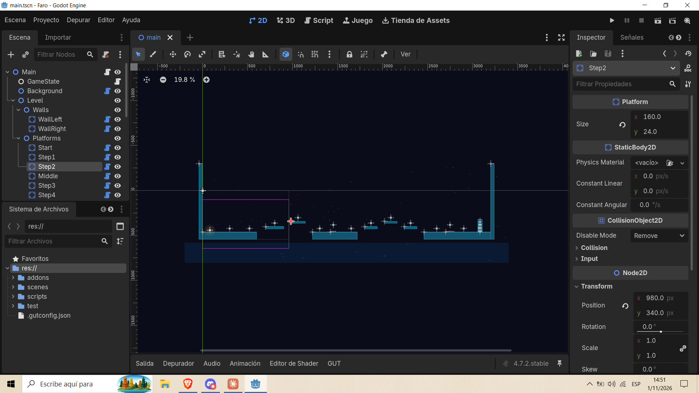
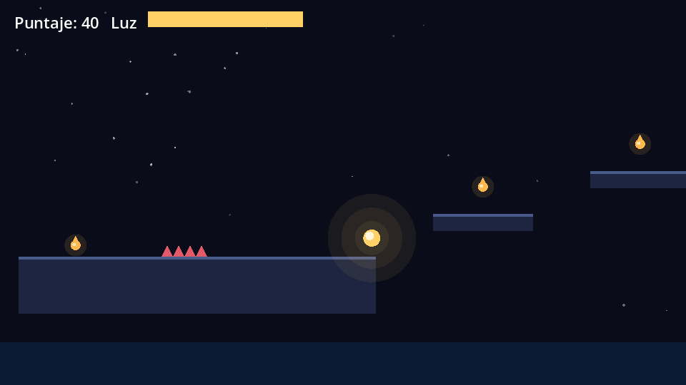
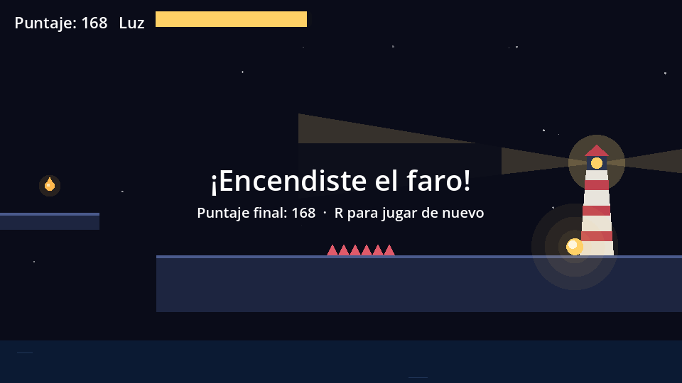
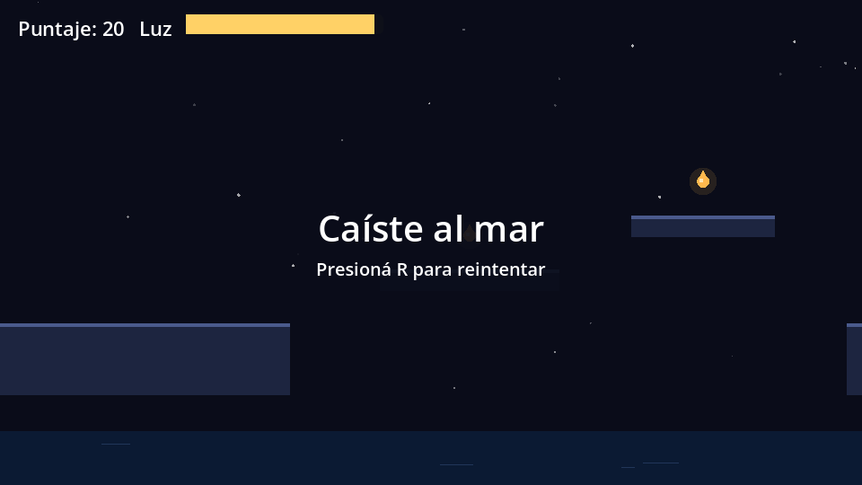
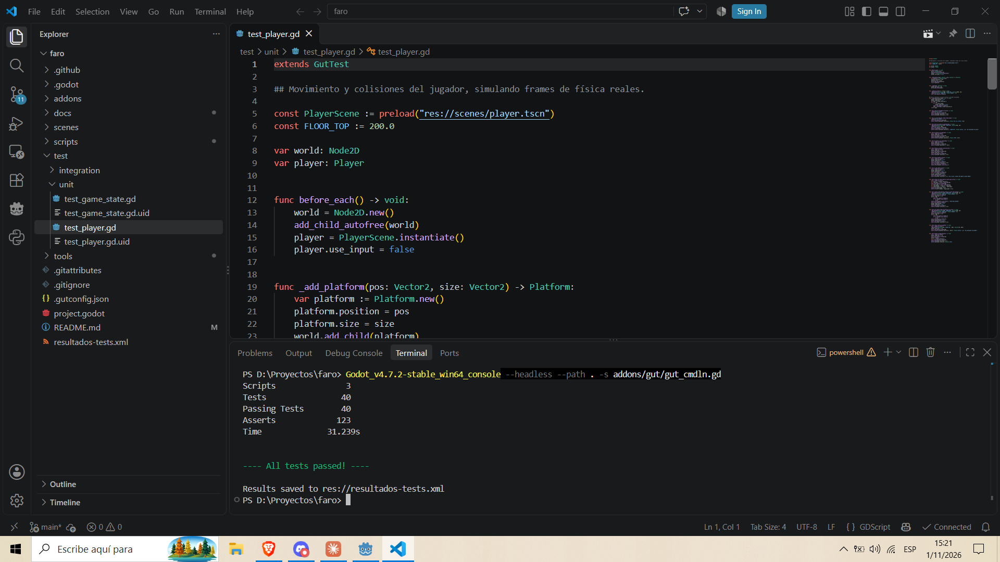
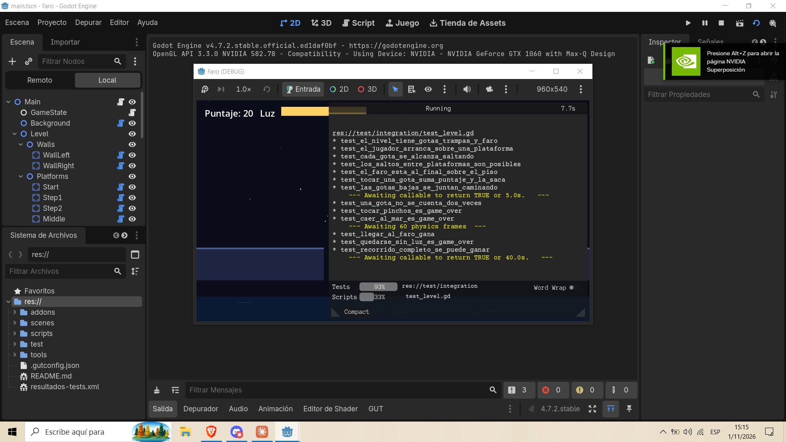
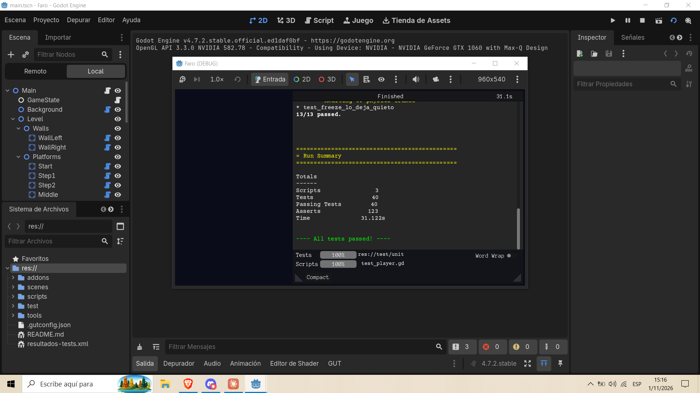
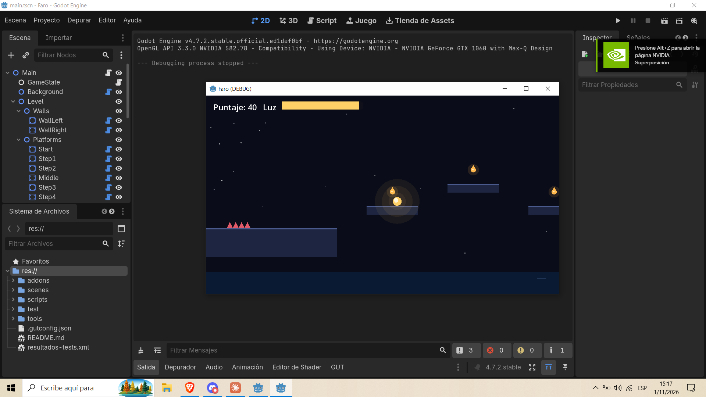
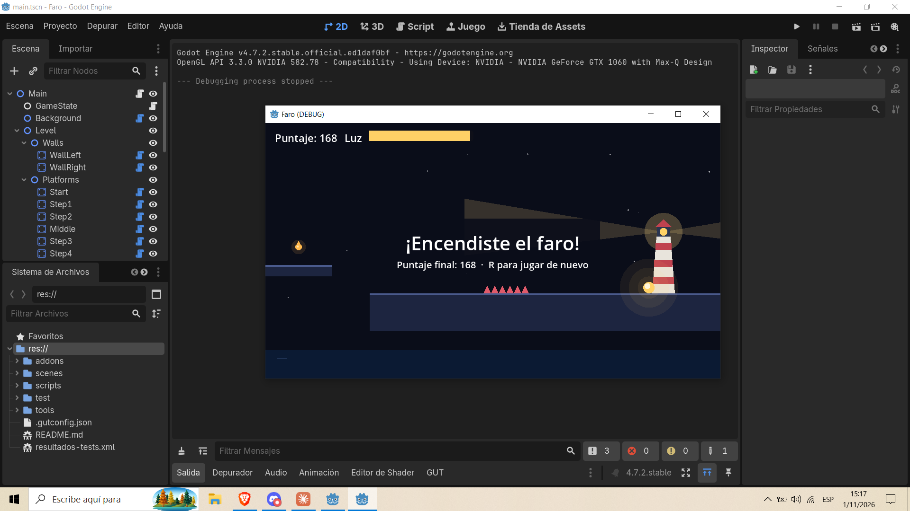

# Faro

[](https://github.com/scheffan/g-faro/actions/workflows/tests.yml)

Plataformero 2D de un nivel hecho en **Godot 4.7**, con **tests automáticos en GUT** que corren en **GitHub Actions** sin pantalla (Godot headless).

Sos una chispa de luz que se va apagando. Juntás gotas de aceite para recargarte y sumar puntos, esquivás pinchos y huecos, y ganás si llegás al faro del final y lo encendés.

El proyecto está pensado como pieza de portfolio de **QA técnico y game testing**: el juego es chico a propósito, y el foco está en cómo se prueba.



| Jugando | Victoria | Game over |
|---|---|---|
|  |  |  |

## Cómo jugar

| Acción | Teclas |
|---|---|
| Moverse | A / D o flechas |
| Saltar (mantener para saltar más alto) | Espacio, W o flecha arriba |
| Reiniciar | R |

Reglas:

- La luz baja 4 puntos por segundo. Si llega a 0, perdés.
- Cada gota suma 10 puntos y recarga 20 de luz (con tope en 100).
- Tocar pinchos o caer al mar es game over.
- Al llegar al faro, la luz que te quedó se suma como bonus.

## Cómo correr el proyecto

1. Instalar [Godot 4.7](https://godotengine.org/download) (la versión estándar, no la de .NET).
2. Abrir `project.godot` desde el gestor de proyectos y apretar F5.

Correr los tests desde la terminal:

```bash
godot --headless --path . --import
godot --headless --path . -s addons/gut/gut_cmdln.gd
```

También se pueden correr desde el editor, en el panel **GUT** de abajo. La configuración está en `.gutconfig.json` y los resultados quedan en `resultados-tests.xml` (formato JUnit).



Otros comandos útiles:

```bash
# Ver al bot jugar el nivel completo
godot --path . -- --demo

# Regenerar las capturas del juego en docs/capturas
godot --path . -s tools/capturar_demo.gd
```

## Estructura

```
scripts/        lógica del juego
  game_state.gd   puntaje, luz y fin de partida (sin física, fácil de testear)
  player.gd       movimiento de la chispa
  main.gd         conecta el nivel con el estado
  autopilot.gd    bot que juega el nivel (para el test de recorrido y la demo)
scenes/         escena principal y jugador
test/unit/      tests de reglas y de movimiento
test/integration/ tests sobre el nivel completo
tools/          script que genera las capturas del juego
.github/workflows/tests.yml   CI con Godot headless
```

## Plan de pruebas

### Objetivo

Verificar que el movimiento, las colisiones, el puntaje y las condiciones de fin funcionan como dicen las reglas, y que el nivel se puede ganar. Todo tiene que correr sin intervención humana en cada push.

### Alcance

| Dentro | Fuera |
|---|---|
| Reglas de la partida (puntaje, luz, game over, victoria) | Rendimiento y FPS |
| Física del jugador (gravedad, salto, fricción, paredes) | Audio (el juego no tiene) |
| Colisiones con gotas, pinchos y faro | Joystick y otras plataformas que no sean PC |
| Diseño del nivel (que todo sea alcanzable) | Pruebas de usabilidad con jugadores |
| Recorrido completo del nivel | |

### Estrategia

El código separa la lógica de la presentación para poder probar cada capa por separado:

1. **Unitarias de reglas** (`test_game_state.gd`): `GameState` no depende de la física, así que se prueba llamando funciones y mirando señales.
2. **Unitarias de movimiento** (`test_player.gd`): el jugador se maneja con variables (`input_dir`, `jump_pressed`, `jump_held`) en lugar de leer el teclado, y los tests simulan frames de física reales sobre plataformas armadas en el test.
3. **Integración** (`test_level.gd`): se carga la escena completa y se prueba el nivel tal como lo juega una persona.
4. **Prueba de humo**: un bot (`autopilot.gd`) juega el nivel de punta a punta y tiene que ganar. Si alguien mueve una plataforma y deja un salto imposible, el test falla.

### Casos de prueba

**Reglas de la partida** (13 casos)

| ID | Caso | Resultado esperado |
|---|---|---|
| GS-01 | Estado inicial | Jugando, luz 100, puntaje 0 |
| GS-02 | Juntar dos gotas | Puntaje 20 y aviso de cambio |
| GS-03 | Pasa 1 segundo | La luz baja según la velocidad configurada |
| GS-04 | Juntar gota con poca luz | Recarga 20 de luz |
| GS-05 | Juntar gota con la luz llena | La luz no supera 100 |
| GS-06 | La luz llega a 0 | Game over por "sin luz", la luz no queda negativa |
| GS-07 | Tocar trampa | Game over por "trampa" |
| GS-08 | Caer al vacío | Game over por "vacío" |
| GS-09 | Varias causas de muerte seguidas | Un solo aviso de game over, gana la primera causa |
| GS-10 | Acciones después del game over | No cambian ni puntaje, ni luz, ni estado |
| GS-11 | Llegar al faro | Victoria y la luz restante se suma como bonus |
| GS-12 | Trampa después de ganar | Sigue en victoria |
| GS-13 | Reiniciar | Vuelve al estado inicial |

**Movimiento y colisiones del jugador** (13 casos)

| ID | Caso | Resultado esperado |
|---|---|---|
| PL-01 | Sin piso | Cae por la gravedad |
| PL-02 | Caída larga | La velocidad de caída tiene tope |
| PL-03 | Cae sobre una plataforma | Queda apoyado, sin atravesarla |
| PL-04 / 05 | Moverse a la derecha / izquierda | Avanza y llega a la velocidad máxima |
| PL-06 | Soltar la dirección | Frena hasta quedar quieto |
| PL-07 | Saltar desde el piso | Sube y deja el piso |
| PL-08 | Saltar de nuevo en el aire | No hay doble salto |
| PL-09 | Soltar el salto enseguida | Salto más corto que manteniendo |
| PL-10 | Saltar justo después de salir del borde | Salta (coyote time de 0,1 s) |
| PL-11 | Saltar 0,2 s después de salir del borde | No salta |
| PL-12 | Correr contra una pared | Se detiene sin atravesarla |
| PL-13 | Congelar al jugador | No se mueve más |

**Nivel completo** (14 casos)

| ID | Caso | Resultado esperado |
|---|---|---|
| LV-01 | Contenido del nivel | Hay más de 10 gotas, pinchos y un faro |
| LV-02 | Inicio | El jugador arranca apoyado en una plataforma |
| LV-03 | Altura de cada gota | Todas se alcanzan con un salto |
| LV-04 | Huecos y subidas entre plataformas | Todos son saltables, con margen |
| LV-05 | Ubicación del faro | Al final y sobre el piso |
| LV-06 | Tocar una gota | Suma puntaje, actualiza el HUD y la gota desaparece |
| LV-07 | Caminar por el piso | Las gotas a ras del piso se juntan sin saltar |
| LV-08 | Dos avisos de la misma gota en un frame | Cuenta una sola vez |
| LV-09 | Tocar pinchos | Game over y cartel "Tocaste los pinchos" |
| LV-10 | Caer por un hueco | Game over por caída al mar |
| LV-11 | Tocar el faro | Victoria, el faro se enciende y aparece el cartel |
| LV-12 | Quedarse sin luz | Game over y la chispa se apaga |
| LV-13 | Recorrido completo con el bot | Gana y junta gotas en el camino |
| LV-14 | Moverse después del game over | El jugador queda congelado |

### Criterios de aceptación

- Los 40 tests pasan en local y en GitHub Actions.
- Ningún test depende del teclado ni de la pantalla.
- Un cambio que rompa una regla hace fallar al menos un test (ver la verificación de abajo).

### ¿Los tests detectan bugs de verdad?

Para comprobarlo, metí bugs a propósito en el código (mutation testing a mano) y corrí la suite cada vez:

| Bug introducido | Tests que fallaron |
|---|---|
| La luz no tiene tope | 2 |
| Se permite el doble salto | 2 |
| Una gota se cuenta dos veces | 1 |
| Sin coyote time | 4 |
| Los pinchos no matan | 1 |
| El salto es más bajo de lo pensado | 3 |

Todos los bugs fueron detectados.

### Bugs encontrados durante el desarrollo

| ID | Severidad | Descripción | Cómo se detectó | Estado |
|---|---|---|---|---|
| BUG-01 | Media | Las gotas a ras del piso no se podían juntar caminando: estaban 28 px arriba del centro del jugador y el radio de contacto es de 22 px. Obligaba a saltar en cada gota. | Revisando la captura de game over: el jugador había pasado por dos gotas con puntaje 0. Se escribió el test LV-07, falló, se bajaron las gotas y pasó. | Corregido |
| BUG-02 | Baja | Con la luz bajando 6 por segundo, sin gotas duraba 16 s y el nivel mínimo pide 14 s: casi no había margen de error. | Jugando a mano. | Corregido (4 por segundo) |
| BUG-03 | Baja (herramientas) | GUT no podía guardar el reporte JUnit porque la carpeta de destino no existía. | Leyendo la salida de la primera corrida. | Corregido |

### Integración continua

`.github/workflows/tests.yml` corre en cada push y pull request:

1. Descarga Godot 4.7.2 para Linux (queda en caché).
2. Importa el proyecto en modo headless.
3. Corre todos los tests con GUT. Si alguno falla, el workflow falla.
4. Sube `resultados-tests.xml` como artefacto y muestra el resumen en la pestaña del workflow.

## Capturas del proceso

| Tests corriendo en el editor | Resultado: 40 de 40 |
|---|---|
|  |  |

| Partida de prueba | Victoria |
|---|---|
|  |  |

## Herramientas

- [Godot 4.7](https://godotengine.org/)
- [GUT 9.7.1](https://github.com/bitwes/Gut) (Godot Unit Test), licencia MIT, incluido en `addons/gut`
- GitHub Actions
